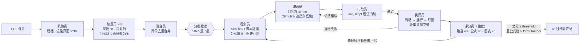

<div align="center">

# MATLAB Workflow MCP

**让 ZCode 驾驶本地 MATLAB / Simulink 的插件 + 仿真评分工作流**

[](https://www.mathworks.com)
[](https://www.python.org)
[](https://github.com/HZZ2Z/Zcode_matlab_workflow_mcp)
[](https://github.com/HZZ2Z/Zcode_matlab_workflow_mcp)
[](LICENSE)

一个仓库，两件东西：

| 组件 | 内容 |
|---|---|
| **插件** `matlab-mcp` | 常驻 MATLAB/Simulink 会话的 MCP 服务器：作业队列、变量读写、图表导出、checkcode 门禁、Simulink 实时快照 |
| **工作流** `matlab-sim` | 拆解 PDF 课件仿真题，逐题走 *规划 → 编码 → 门禁 → 运行 → 独立评分* 的返工循环 |

</div>

## 📦 安装

### 前置要求

| 依赖 | 版本 | 说明 |
|---|---|---|
| MATLAB | **R2025b** | `matlabengine` 包版本必须与 MATLAB 版本一致（25.2.*） |
| Python | 3.10 – 3.12 | `pyproject.toml` 限定 |
| ZCode | 任意近期版本 | 支持 MCP 插件 + 动态工作流 |

> 已在 **Windows** + MATLAB R2025b 验证。插件入口写的是 Windows 写法 `.venv/Scripts/python.exe`，Linux/macOS 用户请把 `.zcode-plugin/plugin.json` 里的命令改为 `.venv/bin/python`。

### 1. 以 ZCode 插件安装

在 ZCode 中：**Plugin Marketplace → Add → Add Plugin Marketplace**，粘贴本仓库地址：

```
https://github.com/HZZ2Z/Zcode_matlab_workflow_mcp.git
```

然后从 `dev-matlab-mcp-local` 市场安装 **MATLAB MCP**。

### 2. 创建 Python 环境（必须）

插件从插件目录内的 `.venv` 启动服务器，clone 后需先建环境：

```bash
cd Zcode_matlab_workflow_mcp
python -m venv .venv
.venv/Scripts/python -m pip install -e .
```

若 `matlabengine==25.2.*` 无法从 PyPI 解析，安装 MATLAB 自带的引擎包：

```bash
.venv/Scripts/python -m pip install "C:/Program Files/MATLAB/R2025b/extern/engines/python"
```

### 3. 冒烟测试（可选）

需先装 pytest（`.venv/Scripts/python -m pip install pytest`），会启动真实 MATLAB 会话，约 1 分钟：

```bash
.venv/Scripts/python -m pytest tests/test_smoke.py -v
```

## ⚙️ 配置

- `MATLAB_MCP_WORKDIR`（可选）：MATLAB 启动目录，插件安装时默认指向当前工程目录。
- 若此前在 `mcpServers` 里手动配过同名服务器，删除它以免重复注册。
- 首次调用工具需 10–20 s 预热（服务器启动时已在后台预热引擎），之后会话常驻。

### 安装工作流

把 [`workflows/matlab-sim.dwf.ts`](workflows/matlab-sim.dwf.ts) 复制到 ZCode 工作流目录（如 `~/.zcode/workflows/`），或直接把文件内容保存为自己的工作流。

> 工作流依赖 **pdf-courseware** skill 做拆题渲染，已随插件分发（`skills/pdf-courseware/`），装好插件即可用；`pdfTool` 参数留空会按 skill 说明自动定位。

## 🏗️ 工作流架构（matlab-sim）

输入一份 PDF 课件，工作流把其中的例题/习题逐题转成 MATLAB/Simulink 仿真产物（`.m` 脚本 + `.slx` 模型 + PNG 图），并由**独立评分员**按分数验收，不过线就带着具体评语返工。



**三层防作弊设计**：

1. **拆题**：文本层公式是乱码，读题员一律从渲染出的页面图像抄录；
2. **门禁**：每版脚本先过 `lint_script`（仅语法错误拦截，两次重试不烧返工轮），干净才许运行；
3. **评分**：评分员没有参与规划编码，理论值自己推导、仿真值自己用 `get_variable` 重新取数核对，不采信任何人的转述。

### 角色一览

| 角色 | 职责 |
|---|---|
| 统筹员 | 建产物目录、渲染课件、切分读题段 |
| 读题员 ×N | 并行扫描页段，逐题抄录题面与公式 |
| 整合员 | 合并各段候选题，跨页/重复题去重 |
| 规划员 | 选 Simulink 或脚本途径，推导公式与图表计划 |
| 编码员 | 写自包含 `sim.m`（Simulink 途径用 `new_system/add_block` 搭模） |
| 门禁员 | `lint_script` 语法门禁，原样转述错误 |
| 执行员 | 清场、运行、导图、收集变量，一轮完成即报 |
| 评分员 | 独立打分 40+40+20，给出具体数字证据与返工意见 |

### 评分标准

| 档位 | 满分 | 要求 |
|---|---|---|
| 代码能跑通 | 40 | lint 干净且完整运行 |
| 结果符合公式预期 | 40 | 评分员自行推导理论值，与仿真值数字对比 |
| 图表可读 | 20 | 标题、轴标签、单位、图例齐全 |

### 参数

| 参数 | 默认 | 说明 |
|---|---|---|
| `courseware` | 必填 | PDF 课件绝对路径 |
| `batch` | 2 | 同时推进的题数 |
| `threshold` | 85 | 过线总分下限 |
| `formulaFloor` | 32 | 公式预期档最低分 |
| `maxRounds` | 5 | 每题最大返工轮数 |
| `outputBase` | `~/Desktop/matlab-sim` | 产物根目录（自动建带时间戳子目录） |
| `pdfTool` | 留空自动定位 | `pdf_tools.py` 绝对路径，特殊安装布局时才需指定 |

## 📁 仓库结构

```
Zcode_matlab_workflow_mcp/
├── .zcode-plugin/plugin.json   # 插件清单（MCP server 入口）
├── marketplace.json            # 本地/远程市场目录
├── skills/
│   ├── matlab/                 # MATLAB MCP 使用 skill
│   └── pdf-courseware/         # 拆题渲染工具（matlab-sim 工作流依赖）
├── src/matlab_mcp/             # MCP 服务器（engine.py 会话/队列, server.py 工具注册）
├── workflows/                  # 动态工作流
│   └── matlab-sim.dwf.ts       # 课件仿真评分流水线
├── tests/test_smoke.py         # 真实 MATLAB 冒烟测试
└── pyproject.toml
```

执行通道走 `mcp__matlab__` 插件工具（常驻会话 + FIFO 作业队列，多 agent 并发安全）；产物默认存桌面 `matlab-sim` 目录。任意 MATLAB 代码都可经此执行——只在你信任的 MATLAB 环境和提示下使用。

## License

[MIT](LICENSE) © HZZ2Z
